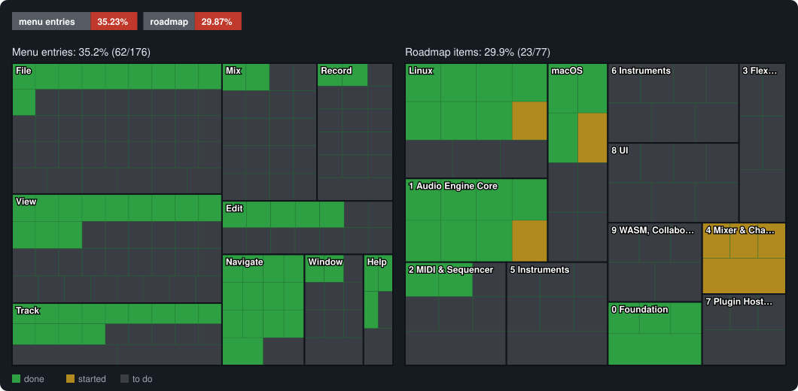

# Pro Wave

**ProWave** is an open-source music production DAW in pure Rust, with a look and
workflow modelled on Apple's Logic Pro. It is drawn entirely with [egui](https://github.com/emilk/egui)
and plays audio through [cpal](https://github.com/RustAudio/cpal): no Electron, no JUCE.

> **Status:** early development. Tracks, MIDI and audio regions, MIDI and audio recording, the
> Piano Roll, the Mixer with effects and automation, the Library and the built-in synthesizer
> work; most of Logic's instruments and many editing commands are still to come. [`ROADMAP.md`](ROADMAP.md) has the full plan and
> [`resume.md`](resume.md) a detailed status of what works today.


<table>
  <tr>
    <td></td>
    <td></td>
  </tr>
  <tr>
    <td align="center">Piano Roll with quantize and velocity lane</td>
    <td align="center">Playback with live channel meters</td>
  </tr>
</table>

ProWave is an independent project. It is not affiliated with, sponsored by or endorsed by Apple
Inc. Logic Pro is a trademark of Apple Inc., used here only to describe the workflow ProWave
follows. ProWave contains no Apple code, artwork or sounds.

## Status

How much of the app works today, counted from the source: a menu entry is done when it can be
used, and a roadmap item when it is ticked in [`ROADMAP.md`](ROADMAP.md). Run `cargo xtask status`
to update this section.

<!-- status:start (made by `cargo xtask status`) -->


| | Done | Started | Total | Done % |
| --- | ---: | ---: | ---: | ---: |
| Menu entries | 62 | 0 | 176 | 35.23% |
| Roadmap items | 23 | 7 | 77 | 29.87% |
<!-- status:end -->

## What works

- **Engine** (`prowave-engine`): sample-accurate transport with cycle, metronome and a tempo map;
  a lock-free command queue between UI and audio thread, with no allocations on the audio
  thread; a built-in subtractive synthesizer with drum-kit modes (48 voices); per-track volume,
  pan, mute, solo and meters; WAV, AIFF, FLAC, MP3 and CAF regions streamed from disk.
- **Tracks area:** ruler, cycle band, playhead, track headers, MIDI and audio regions with
  waveforms; move, repeat and delete regions with snapping; per-track heights.
- **Piano Roll:** draw, select, move, resize and delete notes; quantize (with strength and swing),
  scale quantize, velocity lane, playable keyboard.
- **Mixer:** channel strips with sends, pan, faders and meters; Library patches that change a
  track's instrument and sound; Region and Track inspectors applied non-destructively.
- **Projects:** `.prowave` files (a zip with `project.json` and the audio in `media/`).
- **Time signatures:** any signature, including compound meters such as 6/8 and 7/8.

## Downloads

Get the latest build from the [Releases page](https://github.com/fabox-os/Pro-Wave/releases)
(each version is a pre-release while Pro Wave is in early development):

| System | File |
|---|---|
| Windows 10/11 x64 | `prowave-windows-x86_64.zip`: unzip and run `prowave.exe` |
| macOS (Apple Silicon + Intel) | `prowave-macos-universal.zip` with `Pro Wave.app` (ad-hoc signed, not notarized) |
| Debian, Ubuntu, Mint | `.deb` |
| Fedora, openSUSE, RHEL 9+ | `.rpm` |
| Any Linux | AppImage, Flatpak bundle, or `prowave-linux-x86_64.tar.gz` with an `install.sh` |

The files are not code signed, so Windows SmartScreen and macOS Gatekeeper warn before running
them; the release notes say how to continue.
Linux install steps for every format, the libraries needed and troubleshooting are in
[`dist/README-linux.txt`](dist/README-linux.txt). The Linux and macOS packages have not been
tested on real hardware yet; reports are welcome.

Pushing a version tag such as `v0.1.2` runs the [Release builds](.github/workflows/release.yml)
workflow, which builds every package, test-installs the Linux ones and publishes the Release.
Running it by hand from the Actions tab builds the packages as workflow artifacts without
publishing.

## Run from source

```sh
cargo run --release -p prowave-app                  # the app
cargo run --release -p prowave-app -- song.prowave   # open a project
cargo run --release -p prowave-app -- drums.wav      # new project, import audio files
cargo run --release -p prowave-app -- --play         # start playing right away
cargo run --release -p prowave-app -- --piano        # open the Piano Roll on start
cargo run -p prowave-engine --example beep           # 440 Hz test tone, reports output latency
```

Linux uses Ctrl where macOS uses Cmd: Space plays and stops, Ctrl+N/O/S new, open and save,
Ctrl+R repeats a region, and Y, I and X toggle the Library, Inspector and Mixer.

## Building

Rust stable is required. On Linux, install ALSA's development files and `pkg-config` first:

| Distribution family | Packages |
|---|---|
| Debian, Ubuntu, Mint | `libasound2-dev pkg-config` |
| Fedora, RHEL | `alsa-lib-devel pkgconf-pkg-config` |
| Arch, Manjaro, EndeavourOS | `alsa-lib pkgconf` |

```sh
cargo build --release -p prowave-app   # the program is target/release/prowave
cargo xtask check                      # fmt, clippy -D warnings, tests, no-alloc check, cargo-deny, wasm check
```

## Workspace

| Crate | What it is |
|---|---|
| [`crates/prowave-engine`](crates/prowave-engine) | Real-time audio engine: transport, tempo map, synth, mixer, disk streaming, cpal output |
| [`crates/prowave-app`](crates/prowave-app) | The desktop app (egui): every view and editor |
| [`crates/prowave-project`](crates/prowave-project) | The `.prowave` project file format |
| [`xtask`](xtask) | `cargo xtask check`, `wasm-check` and `rt-check` |
| [`dist/linux`](dist/linux) | Linux desktop entry, icon, MIME type, `install.sh` and the .deb, .rpm and Flatpak recipes |

## Documentation

| | |
|---|---|
| [`ROADMAP.md`](ROADMAP.md) | The Logic Pro feature inventory and the phased plan |
| [`resume.md`](resume.md) | Current status, phase by phase |
| [`AGENTS.md`](AGENTS.md) | Rules for contributors and AI agents: crate ownership, audio-thread rules, checks |
| [`dist/README-linux.txt`](dist/README-linux.txt) | Installing and troubleshooting on Linux |
| [`LOGICX-FORMAT-SPEC.md`](LOGICX-FORMAT-SPEC.md) | Notes for reading Logic Pro `.logicx` projects |
| [`SECURITY.md`](SECURITY.md) | Reporting security problems |

## License

Copyright (C) 2026 the ProWave contributors.

ProWave is free software: you can redistribute it and/or modify it under the terms of the
[GNU General Public License](LICENSE) as published by the Free Software Foundation, either
version 3 of the License, or (at your option) any later version (GPL-3.0-or-later).
Contributions are licensed the same way.

ProWave is distributed in the hope that it will be useful, but WITHOUT ANY WARRANTY; without
even the implied warranty of MERCHANTABILITY or FITNESS FOR A PARTICULAR PURPOSE. See the
[`LICENSE`](LICENSE) file for details.
