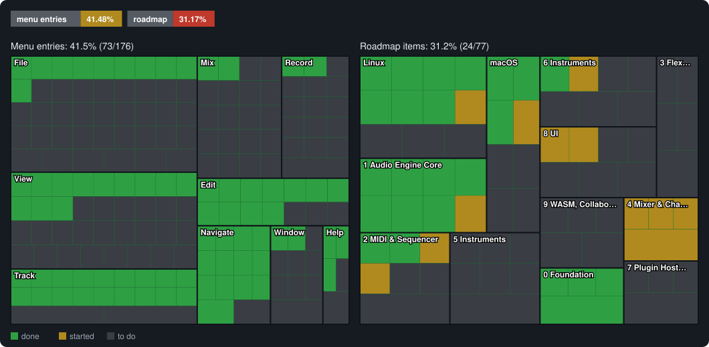

<p align="center"></p>

<h1 align="center">Pro Wave</h1>

<p align="center"><b>An open-source music production app in pure Rust, with the look and workflow of Logic Pro.</b></p>

<p align="center">Tracks, MIDI and audio, a Piano Roll, a Mixer with real effects and automation, and a lock-free real-time engine. Drawn with egui, played through cpal: no Electron, no JUCE.</p>

<p align="center">
  <a href="https://github.com/fabox-os/Pro-Wave/actions"></a>
  <a href="https://github.com/fabox-os/Pro-Wave/releases"></a>
  
  
</p>

<p align="center">
  <a href="https://fabox-os.github.io/Pro-Wave/">Website</a> •
  <a href="#downloads">Download</a> •
  <a href="#features">Features</a> •
  <a href="#building">Build from source</a> •
  <a href="#workspace">Architecture</a> •
  <a href="ROADMAP.md">Roadmap</a> •
  <a href="AGENTS.md">Contributing</a>
</p>


<table>
  <tr>
    <td></td>
    <td></td>
  </tr>
  <tr>
    <td align="center">Piano Roll with quantize and velocity lane</td>
    <td align="center">Playback with live channel meters</td>
  </tr>
</table>

ProWave is an independent project. It is not affiliated with, sponsored by or endorsed by Apple
Inc. Logic Pro is a trademark of Apple Inc., used here only to describe the workflow ProWave
follows. ProWave contains no Apple code, artwork or sounds.

## Status

How much of the app works today, counted from the source: a menu entry is done when it can be
used, and a roadmap item when it is ticked in [`ROADMAP.md`](ROADMAP.md). Run `cargo xtask status`
to update this section.

<!-- status:start (made by `cargo xtask status`) -->


| | Done | Started | Total | Done % |
| --- | ---: | ---: | ---: | ---: |
| Menu entries | 88 | 0 | 180 | 48.89% |
| Roadmap items | 24 | 12 | 77 | 31.17% |
<!-- status:end -->

Pro Wave does a lot, and aims to do it the way Logic Pro does. It is a full DAW: arranging, recording, editing, mixing and bouncing in one window, on an engine built so the audio thread never waits.

> **Note:** Pro Wave is alpha software. The project file format may still change, so keep backups. Plug-in hosting, Live Loops and much of Logic's instrument list are still to come: [`ROADMAP.md`](ROADMAP.md) says what.

## Features

- **Real-time engine.** Sample-accurate transport with cycle, metronome, count-in and a tempo and signature map (any meter, including 6/8 and 7/8). A lock-free command queue between the UI and the audio thread, with no allocation, locks or disk access on the audio thread. 64-bit summing and plug-in delay compensation.
- **Tracks and regions.** Audio, Instrument, Drummer, Pattern, Aux, VCA, Folder and External MIDI tracks. Move, repeat, cut, copy, paste, split, join and delete regions with snapping; Paste Replace, Bounce in Place and Bounce and Join; undo with a jumpable history.
- **Recording.** MIDI and audio recording with count-in, cycle and takes. Follow or send MIDI clock and MIDI Time Code; MIDI output with program, bank, pitch bend and SysEx.
- **Piano Roll, Score and more editors.** Draw, select, move and resize notes; time and scale quantize with strength and swing; velocity lane, Event List, Step Sequencer and MIDI Transform. A Score view with clefs, key and time signatures, rests and ties, and **MusicXML export**.
- **Mixer and automation.** Channel strips with sends, buses, groups, VCA, pan, faders and meters. Automation for faders, pan, send levels and every effect parameter, with Read, Touch, Latch and Write modes.
- **Real effects.** Channel EQ, Multi-Band EQ, Compressor, **Multi-Band Compressor**, Noise Gate, Limiter, **Space Designer** convolution reverb (Volume and Filter envelopes, X-Over, Output EQ, mastering presets), Tape Delay, Chorus, Phaser, Overdrive, Filter and the **Amp Designer** for guitar and bass. They work on any strip, **including the Stereo Out**.
- **Instruments and sounds.** A built-in subtractive synthesizer with drum-kit modes (48 voices), **SoundFont (.sf2)** instruments, **Hydrogen drum kits**, and Library patches that set a track's instrument and effects.
- **Flex Time, Flex Pitch and Smart Tempo.** Warp and re-pitch audio, detect tempo, and make a project follow a recording.
- **Audio regions.** WAV, AIFF, FLAC, MP3, CAF, OGG and M4A streamed from disk; region gain, fades, crossfades, reverse and normalize, never destructive.
- **Bounce and export.** Bounce the project or a cycle section to a 32-bit WAV, export one track, and write the selection as a MIDI file.
- **Open formats.** `.prowave` projects (a zip with `project.json` and the audio in `media/`), MIDI files (including SMPTE time and markers), audio files, and the audio of GarageBand projects.
- **Light on resources.** A program of about 15 MB that starts in a few hundred milliseconds. See [`LINUX-MACOS-LIGHTWEIGHT.md`](LINUX-MACOS-LIGHTWEIGHT.md).
- **Command line.** `prowave --help`, `--play`, `--bench` and `--layout-shots`.
- **Linux, macOS and Windows.** Releases for all three, as .deb, .rpm, AppImage, Flatpak, a macOS app and a Windows zip.

## Downloads

Get the latest build from the [Releases page](https://github.com/fabox-os/Pro-Wave/releases)
(each version is a pre-release while Pro Wave is in early development):

| System | File |
|---|---|
| Windows 10/11 x64 | `prowave-windows-x86_64.zip`: unzip and run `prowave.exe` |
| macOS (Apple Silicon + Intel) | `prowave-macos-universal.zip` with `Pro Wave.app` (ad-hoc signed, not notarized) |
| Debian, Ubuntu, Mint | `.deb` |
| Fedora, openSUSE, RHEL 9+ | `.rpm` |
| Any Linux | AppImage, Flatpak bundle, or `prowave-linux-x86_64.tar.gz` with an `install.sh` |

The files are not code signed, so Windows SmartScreen and macOS Gatekeeper warn before running
them; the release notes say how to continue.
Linux install steps for every format, the libraries needed and troubleshooting are in
[`dist/README-linux.txt`](dist/README-linux.txt). The Linux and macOS packages have not been
tested on real hardware yet; reports are welcome.

Pushing a version tag such as `v0.1.2` runs the [Release builds](.github/workflows/release.yml)
workflow, which builds every package, test-installs the Linux ones and publishes the Release.
Running it by hand from the Actions tab builds the packages as workflow artifacts without
publishing.

## Run from source

```sh
cargo run --release -p prowave-app                  # the app
cargo run --release -p prowave-app -- song.prowave   # open a project
cargo run --release -p prowave-app -- drums.wav      # new project, import audio files
cargo run --release -p prowave-app -- --play         # start playing right away
cargo run --release -p prowave-app -- --piano        # open the Piano Roll on start
cargo run -p prowave-engine --example beep           # 440 Hz test tone, reports output latency
```

Linux uses Ctrl where macOS uses Cmd: Space plays and stops, Ctrl+N/O/S new, open and save,
Ctrl+R repeats a region, and Y, I and X toggle the Library, Inspector and Mixer.

## Building

Rust stable is required. On Linux, install ALSA's development files and `pkg-config` first:

| Distribution family | Packages |
|---|---|
| Debian, Ubuntu, Mint | `libasound2-dev pkg-config` |
| Fedora, RHEL | `alsa-lib-devel pkgconf-pkg-config` |
| Arch, Manjaro, EndeavourOS | `alsa-lib pkgconf` |

```sh
cargo build --release -p prowave-app   # the program is target/release/prowave
cargo xtask check                      # fmt, clippy -D warnings, tests, no-alloc check, cargo-deny, wasm check
```

## Workspace

| Crate | What it is |
|---|---|
| [`crates/prowave-engine`](crates/prowave-engine) | Real-time audio engine: transport, tempo map, synth, mixer, disk streaming, cpal output |
| [`crates/prowave-app`](crates/prowave-app) | The desktop app (egui): every view and editor |
| [`crates/prowave-project`](crates/prowave-project) | The `.prowave` project file format |
| [`crates/prowave-logicx-import`](crates/prowave-logicx-import) | Logic Pro `.logicx` bundles: save shapes, active alternative, metadata plists and the ProjectData envelope |
| [`crates/prowave-plugin-host`](crates/prowave-plugin-host) | Sandboxed VST3, Audio Unit and CLAP hosting (macOS Apple Silicon, Windows x64) |
| [`crates/prowave-plugin-helper`](crates/prowave-plugin-helper) | The helper process third-party plug-in code runs in |
| [`xtask`](xtask) | `cargo xtask check`, `wasm-check` and `rt-check` |
| [`dist/linux`](dist/linux) | Linux desktop entry, icon, MIME type, `install.sh` and the .deb, .rpm and Flatpak recipes |

## Documentation

| | |
|---|---|
| [`ROADMAP.md`](ROADMAP.md) | The Logic Pro feature inventory and the phased plan |
| [`resume.md`](resume.md) | Current status, phase by phase |
| [`AGENTS.md`](AGENTS.md) | Rules for contributors and AI agents: crate ownership, audio-thread rules, checks |
| [`dist/README-linux.txt`](dist/README-linux.txt) | Installing and troubleshooting on Linux |
| [`LOGICX-FORMAT-SPEC.md`](LOGICX-FORMAT-SPEC.md) | Notes for reading Logic Pro `.logicx` projects |
| [`GARAGEBAND-FORMAT-SPEC.md`](GARAGEBAND-FORMAT-SPEC.md) | Notes for reading GarageBand `.band` projects (plan for issue #35) |
| [`SECURITY.md`](SECURITY.md) | Reporting security problems |

## License

Copyright (C) 2026 the ProWave contributors.

ProWave is free software: you can redistribute it and/or modify it under the terms of the
[GNU General Public License](LICENSE) as published by the Free Software Foundation, either
version 3 of the License, or (at your option) any later version (GPL-3.0-or-later).
Contributions are licensed the same way.

ProWave is distributed in the hope that it will be useful, but WITHOUT ANY WARRANTY; without
even the implied warranty of MERCHANTABILITY or FITNESS FOR A PARTICULAR PURPOSE. See the
[`LICENSE`](LICENSE) file for details.
